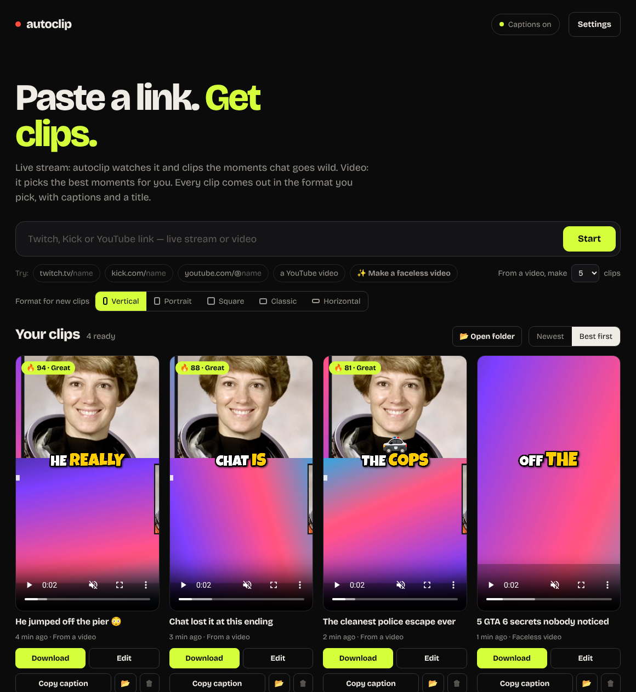
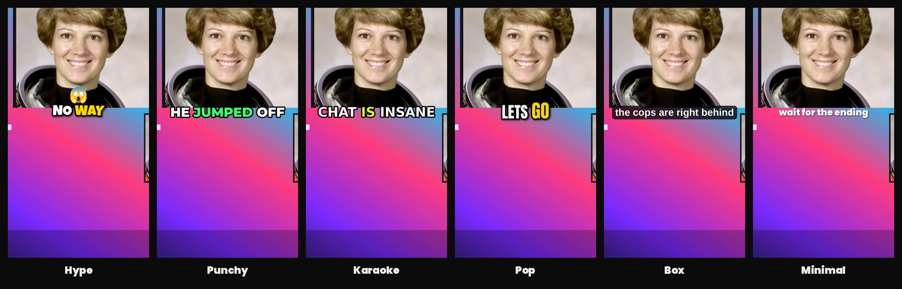
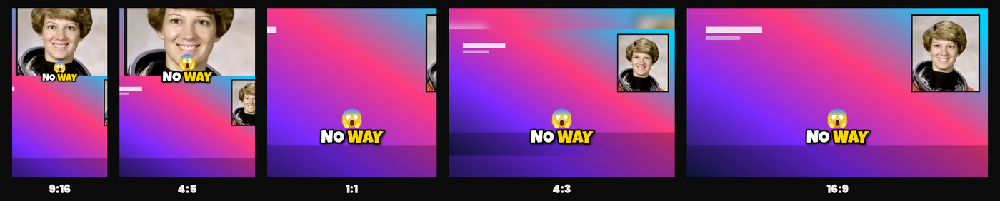
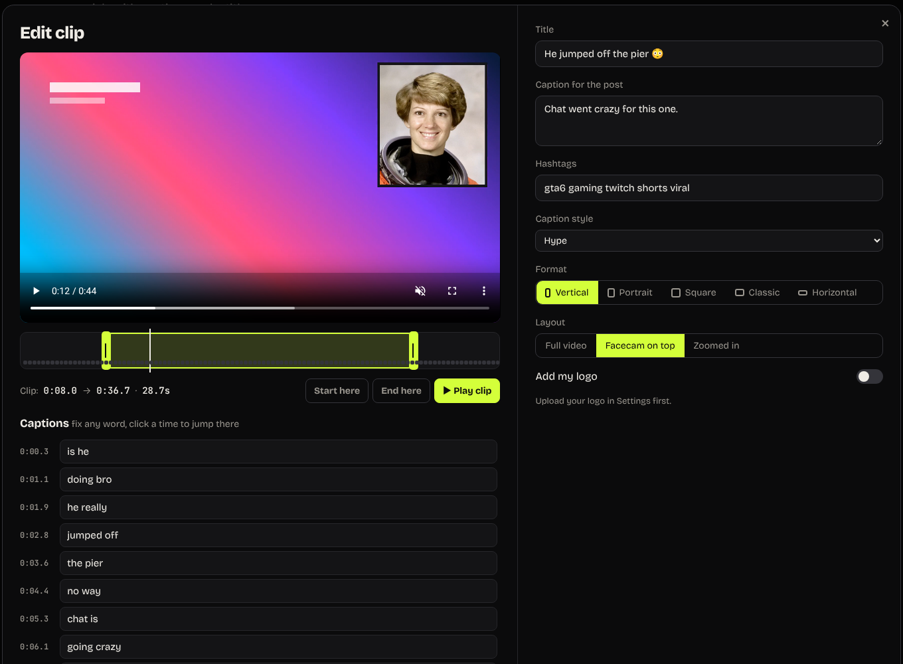
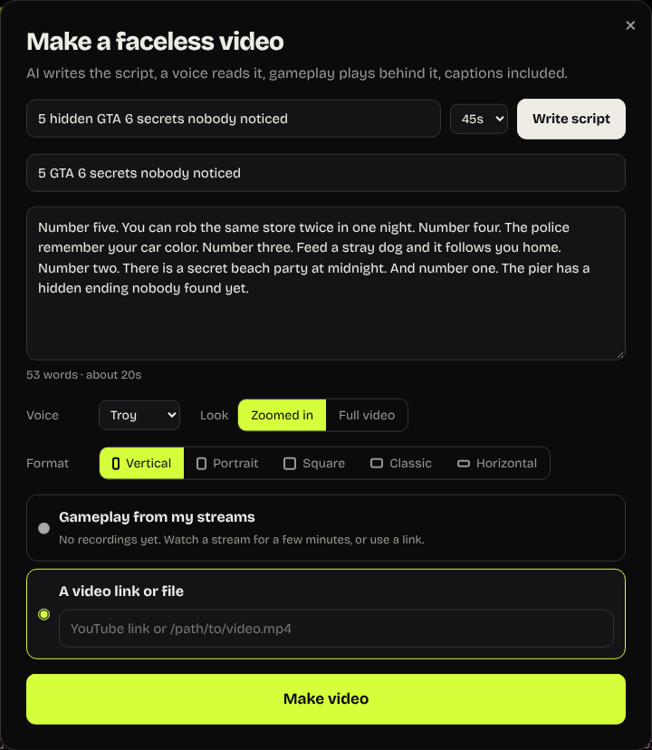
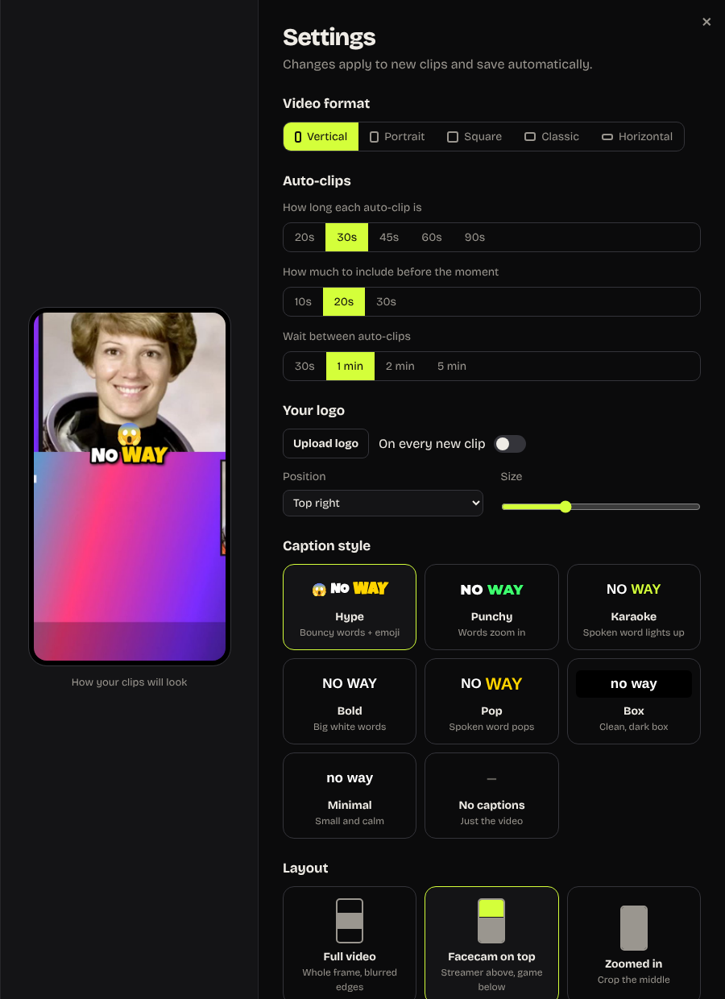

<div align="center">

# Omniscene Autoclip

**Paste a link. Get clips.**

The free, open-source AI clipper for streamers and creators. Turn Twitch, Kick and YouTube
livestreams or any long video into ready-to-post Shorts, Reels and TikToks, with animated
captions, a facecam layout, AI titles and a viral score. It runs on your own computer.

[](LICENSE)
[](#quick-start)
[](#faq)
[](https://omniscene.app)



</div>

---

## Why Autoclip

- **It watches the stream for you.** Add a live channel and walk away. When chat explodes, it cuts the moment.
- **AI picks the best parts of long videos.** Paste a VOD or YouTube link and get the 3 to 12 strongest moments.
- **Every clip is ready to post.** Animated captions, a hook title, a post caption, hashtags and a 0–100 viral score.
- **Free and open source.** MIT-licensed. Anyone can use it, change it and build on it. No subscription, no watermark.
- **Nothing to install by hand.** Run one command and it sets itself up.

## Features

### Live clipping: Twitch, Kick, YouTube Live
Watch several streams at once, each with the live player in the app. Autoclip reads chat in real time and
clips the spikes automatically, with sensitivity you control. Or clip it yourself: **the last 15s / 30s / 60s / 2 min**,
or press **Start clip → End clip** to mark exactly the moment you want.

### Long video → best clips
Paste a YouTube or Twitch VOD link, or pick a file on your computer. Autoclip transcribes the whole thing, reads it
like an editor would, and cuts the strongest self-contained moments, each with a title and a score.

### Captions people actually read


Seven styles (**Hype, Punchy, Karaoke, Bold, Pop, Box, Minimal**) with word-by-word highlighting, bounce and zoom
animations, emoji that match what's being said, and 11 fonts. Every caption is synced to the speech, word by word.

### Facecam on top, gameplay below
Autoclip finds the streamer's webcam on its own (the face that stays in place while the game moves) and stacks it
above the gameplay. You can also pick **Full video** (blurred edges) or **Zoomed in**.

### Any format


Vertical **9:16** for Shorts, Reels and TikTok · **4:5** and **1:1** for feeds · **4:3** · Horizontal **16:9** for YouTube.

### Edit any clip


Drag the start and end, fix any caption word, rewrite the title and hashtags, switch style, layout or format,
add your logo, then press **Save & re-make clip**.

### Faceless videos


Type a topic. AI writes the script (you can edit it), a natural voice reads it, your gameplay or any video plays
behind it, and the captions are synced to the voice. You get a finished Short in about a minute.

### Your brand on every clip
Upload your logo once and choose where it sits. Copy the title, caption and hashtags in one click.



---

## Quick start

You need a Mac or Linux computer with Python 3.10+ and [git](https://git-scm.com). On a Mac, [Homebrew](https://brew.sh) is recommended.

Run these one at a time:

```bash
git clone https://github.com/Huseynbala-Gurbanli/omniscene-autoclip
```
```bash
cd omniscene-autoclip
```
```bash
python3 autoclip.py
```

The first start sets everything up by itself, which takes a minute or two. Then the app opens at **http://localhost:8787**.

1. Paste your free **Groq API key** in the yellow box. Get one at [console.groq.com/keys](https://console.groq.com/keys).
   This turns on captions, AI titles, scores and voices. The key is stored only on your computer.
2. Paste a link and press **Start**.

That's it. Finished videos land in the `clips/` folder; click **📂 Open folder** in the app.

> **Want it without any setup?** Autoclip can be used in **[Omniscene.app](https://omniscene.app)**: same clipping,
> hosted for you. Nothing to install, and it works from any device.

---

## How it works

| Step | What happens | Powered by |
|---|---|---|
| Watch | Records the live stream and reads chat (Twitch, Kick, YouTube) | streamlink, yt-dlp |
| Detect | Counts chat messages every 10 s and flags spikes against the stream's normal level | built in |
| Listen | Word-level transcript | Groq Whisper |
| Judge | Viral score 0–100, hook title, post caption, hashtags; picks moments in long videos | Groq LLM |
| Frame | Finds the facecam, builds the layout in your format | OpenCV (YuNet), ffmpeg |
| Caption | Animated word-by-word captions, emoji, logo | Pillow, ffmpeg |
| Voice | Voiceovers for faceless videos (Mac voice as a fallback) | Groq Orpheus |

Everything runs on your computer. Only audio and text go to Groq for transcription, AI and voices.

---

## FAQ

**Is it really free?**
Yes. Autoclip is MIT-licensed open source. The AI features use your own Groq key, and Groq has a free tier. If you
go past it, you pay Groq directly, not us.

**Which computers does it run on?**
macOS and Linux. Windows isn't supported yet. If your Python is very new (3.15),
Autoclip builds its environment on a stable version automatically.

**Where are my files?**
Finished videos are in `clips/`. Recordings, editor data and settings live in the hidden `clips/.autoclip/` folder.
Full stream recordings can be several GB, so delete old ones in that folder if you need space.

**The Groq voices don't work.**
Open the [Groq Playground](https://console.groq.com/playground) once, choose `canopylabs/orpheus-v1-english`
and accept its terms. Until then, Autoclip uses your Mac's built-in voice.

**Can I post clips of other people's streams?**
Only with permission. Many streamers run clipping programs or allow clips with credit. Check their rules first.
You're responsible for the content you publish.

**Something isn't working.**
Open **Settings → Setup check** in the app. It shows what's ready, and **Test AI now** checks your Groq key for real.
The **Activity log** shows details. If you're still stuck, [open an issue](https://github.com/Huseynbala-Gurbanli/omniscene-autoclip/issues).

---

## Advanced

```bash
python3 autoclip.py <twitch-name> kick.com/<name> youtube.com/@<name>   # start watching right away
python3 autoclip.py --port 8787 --out clips --no-browser --no-captions
```

Environment variables: `GROQ_LLM_MODEL` (default `openai/gpt-oss-120b`), `GROQ_STT_MODEL`
(default `whisper-large-v3-turbo`), `GROQ_TTS_MODEL` (default `canopylabs/orpheus-v1-english`).
Chat-spike tuning lives at the top of `autoclip.py`; auto-clip length, lead-in and cooldown are in Settings.

## Roadmap

- One-click upload to YouTube Shorts, TikTok and Instagram Reels
- Windows support
- B-roll and sound effects
- More voices and languages

Ideas and pull requests are welcome.

## Contributing

1. Fork the repo and create a branch.
2. Run `python3 autoclip.py` and make your change. The app reloads the dashboard from `dashboard.html`.
3. Open a pull request with a short description and a screenshot if it touches the UI.

## Credits

- Face detection: [YuNet](https://github.com/opencv/opencv_zoo/tree/main/models/face_detection_yunet) (MIT). See `models/README.md`
- Fonts: Anton, Bebas Neue, Bangers, Poppins, Montserrat (SIL OFL 1.1), Luckiest Guy (Apache 2.0). See `fonts/README.md`
- Emoji fallback: [Twemoji](https://github.com/jdecked/twemoji) (CC-BY 4.0)
- Built on [streamlink](https://streamlink.github.io), [yt-dlp](https://github.com/yt-dlp/yt-dlp), [ffmpeg](https://ffmpeg.org), [Pillow](https://python-pillow.org), [OpenCV](https://opencv.org) and [Groq](https://groq.com)
- Demo footage in the screenshots uses a public-domain NASA portrait as a stand-in facecam

## License

[MIT](LICENSE) © 2026 Huseyn Gurbanli. Free for personal and commercial use.

<div align="center">
<sub>Made by Huseyn Gurbanli · Autoclip can be used in <a href="https://omniscene.app">Omniscene.app</a></sub>
</div>
